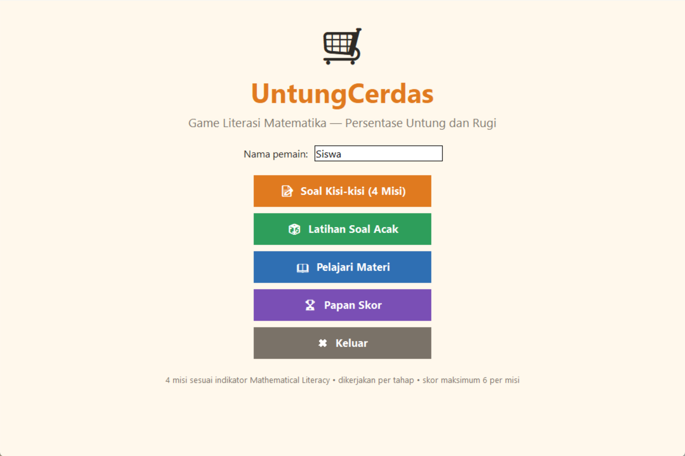
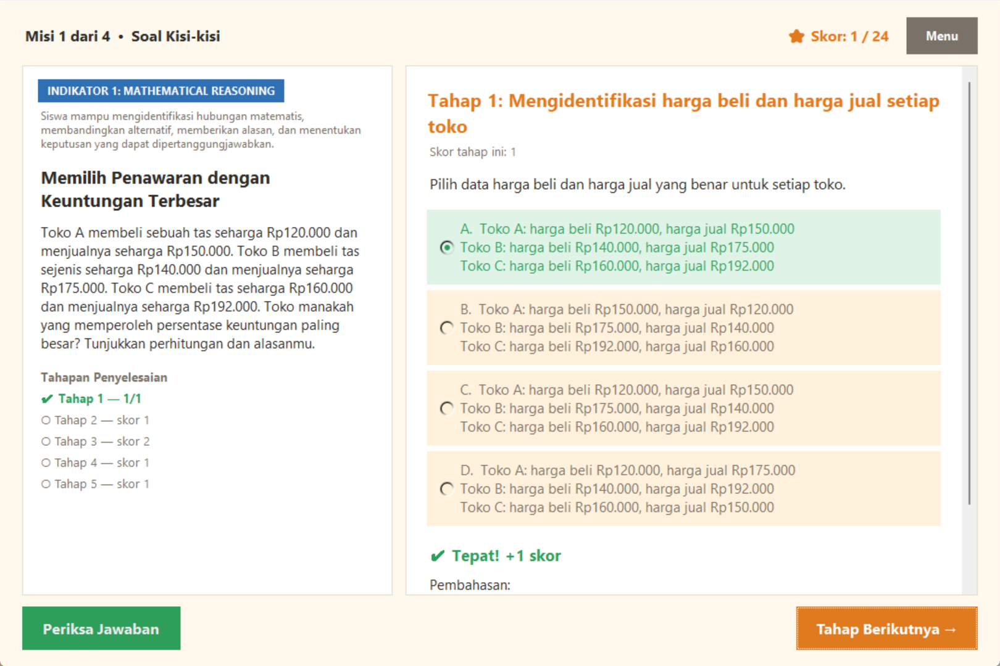
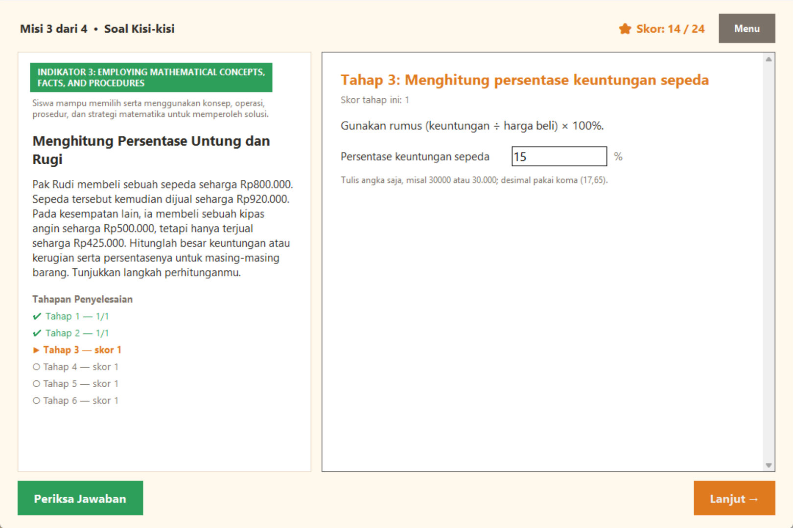
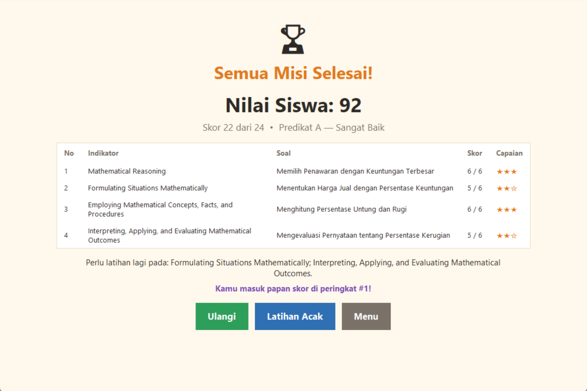
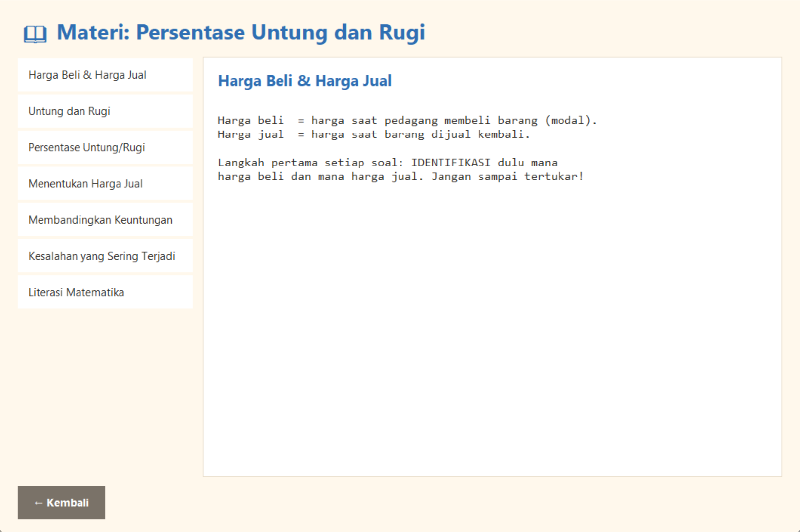

# 🛒 UntungCerdas: Game Pembelajaran Persentase Untung dan Rugi

UntungCerdas adalah aplikasi/game pembelajaran matematika berbasis **Python**.
Siswa berperan sebagai pedagang dan menyelesaikan soal-soal untung dan rugi
**tahap demi tahap**. Setiap tahap langsung dinilai dan dilengkapi pembahasan.

## ▶️ Mainkan Langsung di Browser

👉 **https://alawiahsitituti9-marker.github.io/aritmatika_sosial-/**

Bisa dibuka di laptop maupun HP tanpa instalasi apa pun. Pembukaan pertama memerlukan
sekitar 5–20 detik untuk memuat Python di browser.

Aplikasi tersedia dalam 2 versi yang memakai kode Python yang sama
(`soal.py`, `permainan.py`, `materi.py`):
- **Versi web** (`index.html`): kode Python dijalankan di browser memakai [Pyodide](https://pyodide.org).
- **Versi desktop** (`main.py`): memakai Tkinter, dijalankan dengan `python main.py`.

---

## 🖼️ Tampilan Aplikasi

### 1. Menu Utama


### 2. Mengerjakan Soal: Pilihan Ganda
Soal dan daftar tahapan ada di panel kiri. Tahap yang sedang dikerjakan ada di panel kanan.
Jawaban yang benar ditandai hijau, lalu muncul pembahasan.


### 3. Mengerjakan Soal: Isian Angka


### 4. Hasil Akhir
Menampilkan nilai, predikat, skor, dan bintang tiap indikator.


### 5. Materi


---

## 📋 Langkah-langkah

### A. Langkah Menjalankan Aplikasi

**Versi web:** cukup buka link https://alawiahsitituti9-marker.github.io/aritmatika_sosial-/

**Versi desktop:**

1. **Install Python**
   - Unduh Python 3.10 atau versi yang lebih baru di https://www.python.org/downloads/
   - Saat instalasi di Windows, centang **"Add Python to PATH"**.
2. **Unduh kode aplikasi**
   - Cara 1: klik tombol hijau **Code → Download ZIP** di halaman ini, lalu ekstrak.
   - Cara 2: gunakan git:
     ```bash
     git clone https://github.com/alawiahsitituti9-marker/aritmatika_sosial-.git
     ```
3. **Buka folder aplikasi** di VS Code (**File → Open Folder**).
4. **Buka terminal** di VS Code (**Terminal → New Terminal**).
5. **Jalankan aplikasi**:
   ```bash
   python main.py
   ```
6. Jendela game **UntungCerdas** akan terbuka.

> Tidak perlu install library tambahan karena Tkinter sudah termasuk dalam Python.

### B. Langkah Bermain

1. Tulis **nama pemain** di menu utama.
2. Pilih mode permainan:
   - **📝 Soal Kisi-kisi**: 4 soal utama.
   - **🎲 Latihan Soal Acak**: soal baru dengan angka acak untuk latihan.
3. Baca soal di **panel kiri**.
4. Kerjakan **tahap demi tahap** di panel kanan:
   - Tahap perhitungan: isi jawaban berupa angka, misalnya `30000` atau `30.000`.
   - Tahap identifikasi, model, atau kesimpulan: pilih jawaban A, B, C, atau D.
5. Klik **Periksa Jawaban** (atau tekan Enter), lalu baca **pembahasannya**.
6. Klik **Tahap Berikutnya →** sampai keempat misi selesai.
7. Lihat **hasil akhir**: skor, nilai (0–100), predikat, dan capaian bintang tiap misi.
8. Gunakan menu **📖 Pelajari Materi** untuk membaca rumus dan **🏆 Papan Skor** untuk melihat skor tertinggi.

### C. Langkah Pembuatan Aplikasi

1. **Menentukan materi dan tujuan**: persentase untung dan rugi dengan 4 indikator literasi matematika.
2. **Merancang soal dan tahapan penyelesaian**: setiap soal dipecah menjadi 5–6 tahap, dan tiap tahap diberi skor.
3. **Merancang alur game**: Menu → Misi 1–4 (per tahap) → Hasil akhir.
4. **Menulis kode** dengan Python di VS Code, dibantu Claude Code:
   - logika soal (`soal.py`)
   - logika permainan dan penilaian (`permainan.py`)
   - tampilan GUI (`main.py`)
   - materi dan papan skor (`materi.py`, `skor.py`)
5. **Menguji aplikasi** dengan unit test (`tests/`) dan mencoba memainkannya langsung.
6. **Mengunggah ke GitHub** menggunakan git.

---

## 🗂️ Struktur Aplikasi

### Struktur Folder

```
aritmatika_sosial-/
├── index.html         # Versi web: tampilan game di browser
├── web_api.py         # Versi web: penghubung tampilan web dengan logika Python
├── main.py            # Versi desktop: tampilan game (GUI Tkinter)
├── soal.py            # Bank soal: 4 misi, tahapan, kunci jawaban, pembahasan
├── permainan.py       # Logika permainan: urutan misi/tahap, skor, nilai, predikat
├── materi.py          # Ringkasan materi untung dan rugi
├── skor.py            # Penyimpanan papan skor (file JSON)
├── tests/
│   └── test_soal.py   # Unit test untuk memastikan soal & penilaian benar
├── .gitignore         # Daftar file yang tidak diunggah ke GitHub
└── README.md          # Dokumentasi (file ini)
```

### Penjelasan Setiap File

| File | Fungsi |
|---|---|
| `main.py` | Menampilkan semua layar: menu utama, layar misi, hasil akhir, materi, dan papan skor. File ini yang dijalankan. |
| `soal.py` | Berisi 4 misi beserta tahapannya. Setiap tahap memuat perintah, skor, kunci jawaban, dan pembahasan. Juga berisi pembuat soal acak. |
| `permainan.py` | Mengatur jalannya permainan: memeriksa jawaban, memberi skor tiap tahap, pindah tahap/misi, dan menghitung nilai akhir. |
| `materi.py` | Teks materi: harga beli & jual, untung dan rugi, persentase, menentukan harga jual, dan kesalahan umum. |
| `skor.py` | Menyimpan dan membaca 10 skor tertinggi di file `skor_tertinggi.json`. |
| `index.html` | Halaman web game. Memuat Python di browser (Pyodide) lalu menjalankan `soal.py`, `permainan.py`, dan `materi.py` yang sama. |
| `web_api.py` | Penghubung antara halaman web dan logika game Python. |
| `tests/test_soal.py` | Menguji bahwa kunci jawaban benar dan penilaian berjalan sesuai aturan. |

### Alur Program

```
          ┌─────────────┐
          │  MENU UTAMA │
          └──────┬──────┘
   ┌─────────┬───┴──────┬────────────┐
   ▼         ▼          ▼            ▼
 Soal     Latihan    Materi      Papan Skor
 Kisi-kisi  Acak
   └────┬────┘
        ▼
 ┌────────────────────────────┐
 │ MISI 1 → 2 → 3 → 4         │
 │  tiap misi: Tahap 1 … 6    │
 │  jawab → periksa → bahas   │
 └─────────────┬──────────────┘
               ▼
       ┌───────────────┐
       │  HASIL AKHIR  │  skor, nilai, predikat, bintang
       └───────────────┘
```

### Struktur Soal (Misi dan Tahap)

| Misi | Indikator | Judul Soal | Jumlah Tahap | Skor Maks |
|---|---|---|---|---|
| 1 | Mathematical Reasoning | Memilih Penawaran dengan Keuntungan Terbesar | 5 | 6 |
| 2 | Formulating Situations Mathematically | Menentukan Harga Jual dengan Persentase Keuntungan | 6 | 6 |
| 3 | Employing Mathematical Concepts, Facts, and Procedures | Menghitung Persentase Untung dan Rugi | 6 | 6 |
| 4 | Interpreting, Applying, and Evaluating Mathematical Outcomes | Mengevaluasi Pernyataan tentang Persentase Kerugian | 6 | 6 |

### Sistem Penilaian

- Setiap tahap memiliki skor (umumnya 1). Tahap yang dijawab benar mendapat skor penuh.
- Skor maksimum: **6 per misi**, **24 total**.
- **Nilai = (skor ÷ 24) × 100**

| Nilai | Predikat |
|---|---|
| 90 – 100 | A (Sangat Baik) |
| 75 – 89 | B (Baik) |
| 60 – 74 | C (Cukup) |
| < 60 | D (Perlu Bimbingan) |

---

## 🧪 Menjalankan Pengujian

```bash
python -m unittest discover -s tests -v
```

---

Dibuat menggunakan **VS Code** dan **Claude Code**, dengan bahasa pemrograman **Python**.
