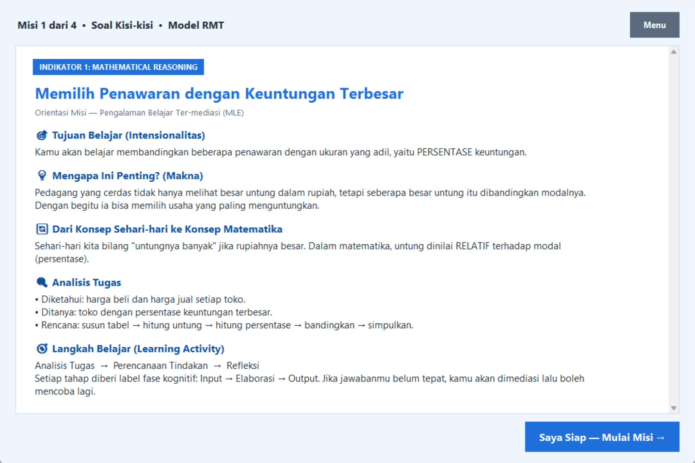
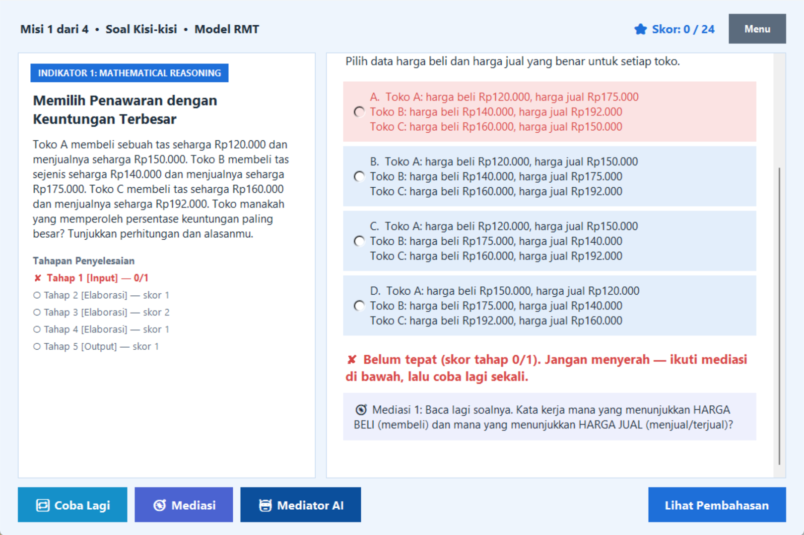
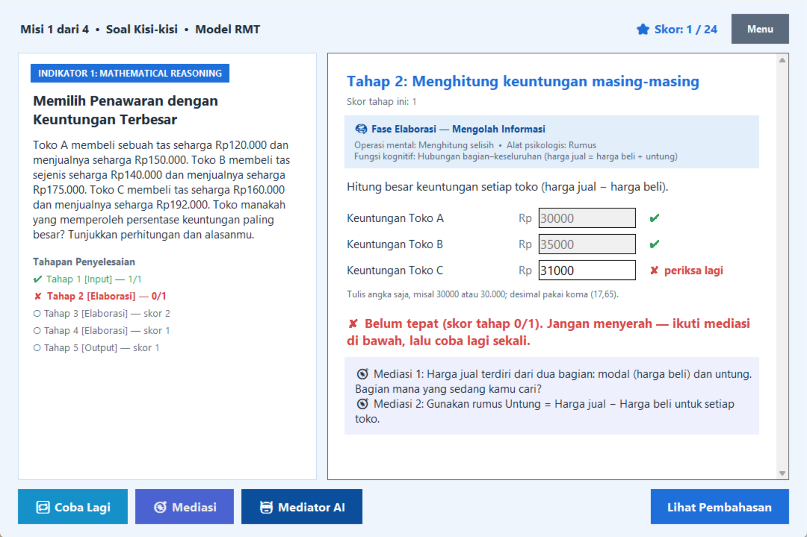
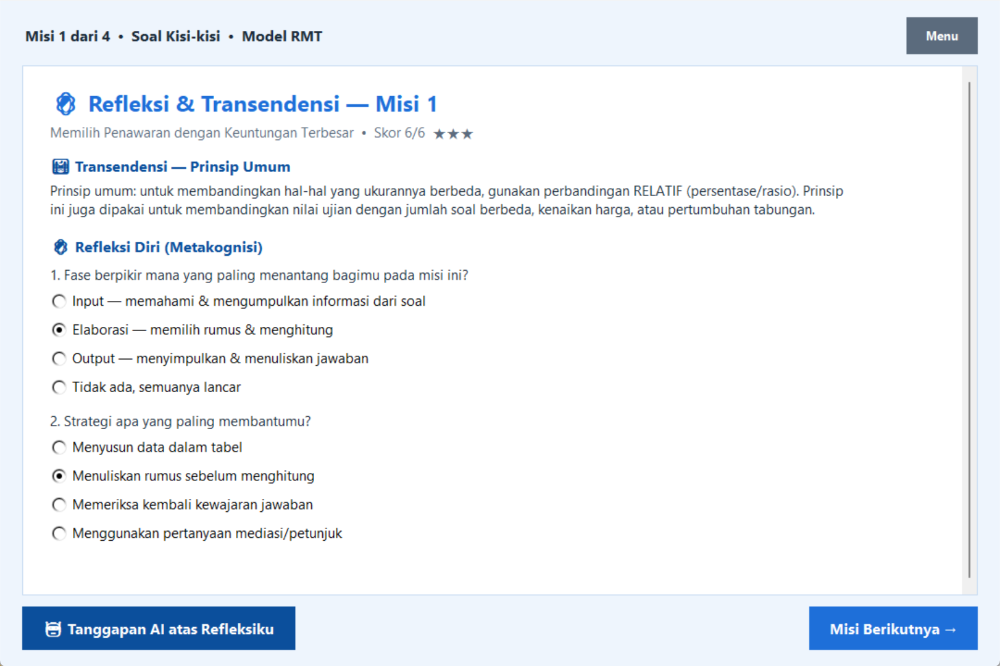
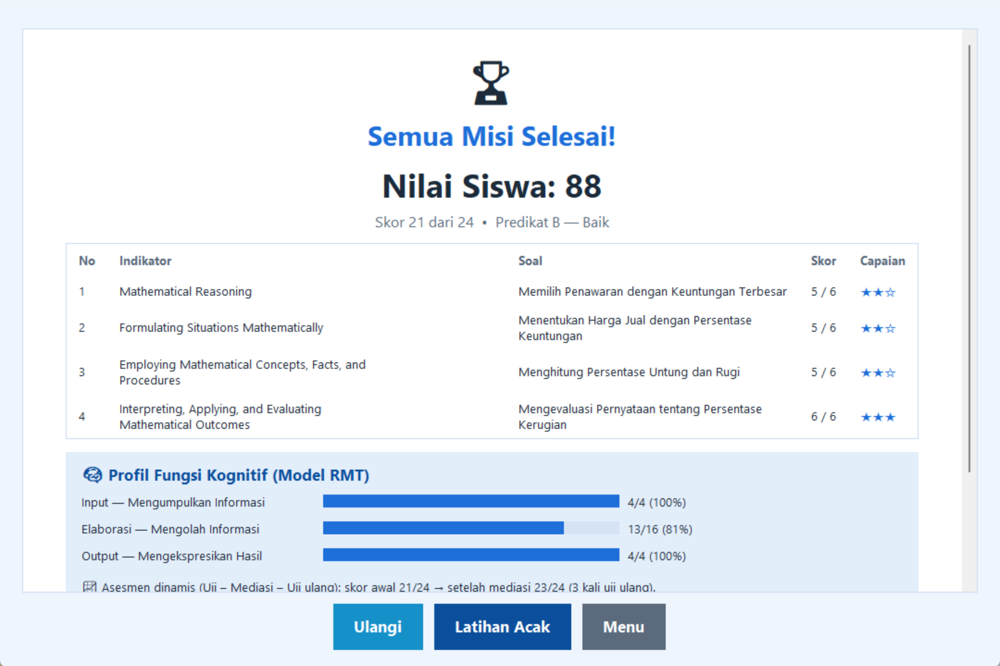
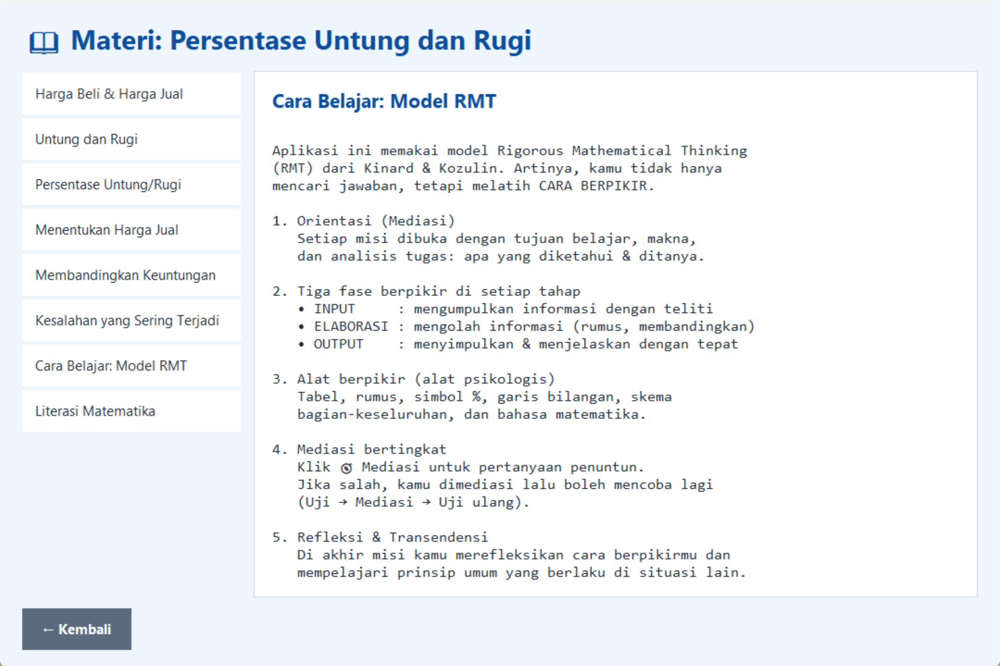

# 🛒 UntungCerdas: Game Pembelajaran Persentase Untung dan Rugi

UntungCerdas adalah aplikasi/game pembelajaran matematika berbasis **Python**.
Siswa berperan sebagai pedagang dan menyelesaikan soal-soal untung dan rugi
**tahap demi tahap**.

- **Model pembelajaran:** *Rigorous Mathematical Thinking* (RMT), Kinard & Kozulin.
- **Kecerdasan buatan:** tutor AI **DeepSeek** yang berperan sebagai *mediator* RMT.

## ▶️ Mainkan Langsung di Browser

👉 **https://alawiahsitituti9-marker.github.io/aritmatika_sosial-/**

Bisa dibuka di laptop maupun HP tanpa instalasi apa pun. Pembukaan pertama memerlukan
sekitar 5–20 detik untuk memuat Python di browser.

Aplikasi tersedia dalam 2 versi yang memakai kode Python yang sama
(`soal.py`, `permainan.py`, `materi.py`):
- **Versi web** (`index.html`): kode Python dijalankan di browser memakai [Pyodide](https://pyodide.org).
- **Versi desktop** (`main.py`): memakai Tkinter, dijalankan dengan `python main.py`.

---

## 🖼️ Tampilan Aplikasi

### 1. Menu Utama


### 2. Orientasi Misi (MLE: Intensionalitas, Makna, Analisis Tugas)


### 3. Jawaban Salah: Mediasi lalu Uji Ulang (Asesmen Dinamis)
Setiap tahap menampilkan fase kognitif, operasi mental, dan alat psikologisnya. Jika salah, kunci
belum ditampilkan. Siswa mendapat pertanyaan mediasi lalu boleh mencoba lagi.


### 4. Soal Isian Angka dengan Mediasi Bertingkat


### 5. Refleksi & Transendensi di Akhir Misi


### 6. Hasil Akhir dan Profil Fungsi Kognitif RMT


### 7. Materi (termasuk "Cara Belajar: Model RMT")

---

## 🧠 Model Pembelajaran: Rigorous Mathematical Thinking (RMT)

RMT (Kinard & Kozulin) memadukan teori sosiokultural **Vygotsky** (alat psikologis, konsep ilmiah,
*Learning Activity*) dan teori **Feuerstein** (*Mediated Learning Experience*, fungsi kognitif,
asesmen dinamis). Berikut cara aplikasi menerapkannya:

| Unsur RMT (ringkasan buku) | Penerapan di aplikasi |
|---|---|
| **MLE: Intensionalitas & Resiprositas** | Setiap misi dibuka dengan layar **Orientasi**: tujuan belajar ditampilkan, lalu siswa merespons dengan "Saya Siap". |
| **MLE: Makna** | Bagian "Mengapa Ini Penting?" di layar Orientasi. |
| **MLE: Transendensi** | Di akhir misi ditampilkan **prinsip umum** yang berlaku di luar soal (misalnya "persen DARI APA?"). |
| **Konsep sehari-hari ke konsep ilmiah** | Bagian "Dari Konsep Sehari-hari ke Konsep Matematika" di setiap misi. |
| **Learning Activity: Analisis Tugas, Perencanaan, Refleksi** | Orientasi berisi analisis tugas (diketahui/ditanya/rencana), tahapan berisi perencanaan sistematis, dan setiap misi ditutup dengan **refleksi metakognisi**. |
| **Fungsi kognitif Input, Elaborasi, Output** | Setiap tahap diberi label fase, beserta **operasi mental** dan **fungsi kognitif** yang dilatih. |
| **Alat psikologis matematika** | Setiap tahap menyebut alat berpikirnya: tabel, rumus, simbol %, garis bilangan, skema bagian–keseluruhan, bahasa matematika. |
| **Mediated questioning** | Tombol **🧭 Mediasi** memberi pertanyaan terpimpin bertingkat tanpa membocorkan jawaban. |
| **Asesmen dinamis / LPAD (Uji, Mediasi, Uji ulang)** | Jika jawaban pertama salah, kunci **tidak** langsung ditampilkan. Siswa dimediasi lalu boleh **mencoba lagi sekali**. Skor resmi tetap dari percobaan pertama (sesuai kisi-kisi), sedangkan hasil uji ulang dicatat sebagai **potensi belajar**. |
| **Diagnostik fase kognitif** | Hasil akhir menampilkan **Profil Fungsi Kognitif** (Input, Elaborasi, Output), fase terlemah, dan rekomendasi latihannya. |

Alur setiap misi:

```
Orientasi (MLE) → Tahap 1…6 [Input → Elaborasi → Output] → Refleksi & Transendensi
                    └─ salah? → Mediasi → Uji ulang → Pembahasan
```

---

## 🤖 Kecerdasan AI (DeepSeek)

Aplikasi terhubung ke model AI **DeepSeek**. AI berperan sebagai **mediator RMT**, bukan pemberi
jawaban:

- **🤖 Mediator AI** (sebelum atau saat mediasi): memberi pertanyaan terpimpin yang sesuai fase kognitif tahap itu, tanpa menyebut jawaban.
- **🤖 Diagnosis AI** (setelah menjawab): mendiagnosis fase kesulitan siswa (Input, Elaborasi, atau Output) dan miskonsepsinya, lalu menutup dengan transendensi.
- **🤖 Tanggapan AI atas Refleksi**: menanggapi refleksi metakognisi siswa di akhir misi.

### Cara mengaktifkan
1. Dapatkan **API key**. Ada dua pilihan penyedia:
   - **DeepSeek resmi**: https://platform.deepseek.com, menu *API Keys*.
   - **OpenRouter**: https://openrouter.ai, menyediakan model DeepSeek **gratis** (model berakhiran `:free`).
2. Buka aplikasi, klik **⚙️ Pengaturan AI**, pilih penyedia, lalu tempel API key.
3. Klik **Tes Koneksi**, lalu **Simpan**.

> 🔒 **Keamanan API key:** key **tidak** ditulis di kode dan **tidak** ikut terunggah ke GitHub.
> Di versi desktop, key disimpan di file `config_ai.json` (sudah masuk `.gitignore`) atau dibaca
> dari variabel lingkungan `DEEPSEEK_API_KEY` / `OPENROUTER_API_KEY`. Di versi web, key disimpan
> di browser perangkat masing-masing. Jangan membagikan API key kepada orang lain.
>
> Untuk versi web disarankan memakai **OpenRouter**, karena server DeepSeek resmi mungkin menolak
> permintaan yang dikirim langsung dari browser.

Tanpa API key, aplikasi tetap bisa dimainkan sepenuhnya. Mediasi bertingkat 🧭 tetap tersedia
karena sudah tertulis di aplikasi.

---

## 📋 Langkah-langkah

### A. Langkah Menjalankan Aplikasi

**Versi web:** cukup buka link https://alawiahsitituti9-marker.github.io/aritmatika_sosial-/

**Versi desktop:**

1. **Install Python**
   - Unduh Python 3.10 atau versi yang lebih baru di https://www.python.org/downloads/
   - Saat instalasi di Windows, centang **"Add Python to PATH"**.
2. **Unduh kode aplikasi**
   - Cara 1: klik tombol hijau **Code → Download ZIP** di halaman ini, lalu ekstrak.
   - Cara 2: gunakan git:
     ```bash
     git clone https://github.com/alawiahsitituti9-marker/aritmatika_sosial-.git
     ```
3. **Buka folder aplikasi** di VS Code (**File → Open Folder**).
4. **Buka terminal** di VS Code (**Terminal → New Terminal**).
5. **Jalankan aplikasi**:
   ```bash
   python main.py
   ```
6. Jendela game **UntungCerdas** akan terbuka.

> Tidak perlu install library tambahan karena Tkinter sudah termasuk dalam Python.

### B. Langkah Bermain

1. Tulis **nama pemain** di menu utama.
2. Pilih mode permainan:
   - **📝 Soal Kisi-kisi**: 4 soal utama.
   - **🎲 Latihan Soal Acak**: soal baru dengan angka acak untuk latihan.
3. Baca layar **Orientasi**: tujuan, makna, dan analisis tugas. Lalu klik **Saya Siap — Mulai Misi**.
4. Kerjakan **tahap demi tahap** di panel kanan. Perhatikan label fase kognitif (Input, Elaborasi, atau Output):
   - Tahap perhitungan: isi jawaban berupa angka, misalnya `30000` atau `30.000`.
   - Tahap identifikasi, model, atau kesimpulan: pilih jawaban A, B, C, atau D.
   - Butuh bantuan? Klik **🧭 Mediasi** atau **🤖 Mediator AI**.
5. Klik **Periksa Jawaban** (atau tekan Enter).
   - Jika benar, pembahasan langsung muncul.
   - Jika salah, ikuti mediasi lalu klik **🔁 Coba Lagi**, atau pilih **Lihat Pembahasan**.
6. Di akhir misi, isi **Refleksi** dan baca **Transendensi** (prinsip umum).
7. Lihat **hasil akhir**: nilai, predikat, bintang tiap indikator, **profil fungsi kognitif**, dan skor setelah mediasi.
8. Gunakan menu **📖 Pelajari Materi** (termasuk "Cara Belajar: Model RMT"), **🏆 Papan Skor**, dan **⚙️ Pengaturan AI**.

### C. Langkah Pembuatan Aplikasi

1. **Menentukan materi dan tujuan**: persentase untung dan rugi dengan 4 indikator literasi matematika.
2. **Merancang soal dan tahapan penyelesaian**: setiap soal dipecah menjadi 5–6 tahap, dan tiap tahap diberi skor.
3. **Menerapkan model RMT** berdasarkan ringkasan buku Kinard & Kozulin: orientasi MLE, fase kognitif, mediasi bertingkat, asesmen dinamis, refleksi, dan transendensi (`rmt.py`).
4. **Menambahkan kecerdasan AI DeepSeek** sebagai mediator RMT (`ai_tutor.py`).
5. **Menulis kode** dengan Python di VS Code, dibantu Claude Code:
   - logika soal (`soal.py`)
   - logika permainan, penilaian, dan uji ulang (`permainan.py`)
   - tampilan desktop (`main.py`) dan web (`index.html`, `web_api.py`)
   - materi dan papan skor (`materi.py`, `skor.py`)
6. **Menguji aplikasi** dengan unit test (`tests/`) dan mencoba memainkannya langsung.
7. **Mengunggah ke GitHub** menggunakan git, lalu menerbitkan versi web dengan GitHub Pages.

---

## 🗂️ Struktur Aplikasi

### Struktur Folder

```
aritmatika_sosial-/
├── index.html         # Versi web: tampilan game di browser
├── web_api.py         # Versi web: penghubung tampilan web dengan logika Python
├── main.py            # Versi desktop: tampilan game (GUI Tkinter)
├── soal.py            # Bank soal: 4 misi, tahapan, kunci jawaban, pembahasan
├── rmt.py             # Model RMT: orientasi MLE, fase kognitif, mediasi, profil diagnostik
├── ai_tutor.py        # Tutor AI DeepSeek (mediator RMT)
├── permainan.py       # Logika permainan: urutan misi/tahap, skor, nilai, predikat
├── materi.py          # Ringkasan materi untung dan rugi
├── skor.py            # Penyimpanan papan skor (file JSON)
├── tests/
│   ├── test_soal.py   # Unit test soal & penilaian
│   └── test_rmt_ai.py # Unit test RMT, asesmen dinamis, dan tutor AI
├── .gitignore         # Daftar file yang tidak diunggah ke GitHub
└── README.md          # Dokumentasi (file ini)
```

### Penjelasan Setiap File

| File | Fungsi |
|---|---|
| `main.py` | Menampilkan semua layar: menu utama, layar misi, hasil akhir, materi, dan papan skor. File ini yang dijalankan. |
| `soal.py` | Berisi 4 misi beserta tahapannya. Setiap tahap memuat perintah, skor, kunci jawaban, dan pembahasan. Juga berisi pembuat soal acak. |
| `permainan.py` | Mengatur jalannya permainan: memeriksa jawaban, memberi skor tiap tahap, pindah tahap/misi, dan menghitung nilai akhir. |
| `materi.py` | Teks materi: harga beli & jual, untung dan rugi, persentase, menentukan harga jual, dan kesalahan umum. |
| `skor.py` | Menyimpan dan membaca 10 skor tertinggi di file `skor_tertinggi.json`. |
| `rmt.py` | Data model RMT: tujuan, makna, analisis tugas, transendensi tiap misi, serta fase kognitif, operasi mental, alat psikologis, dan pertanyaan mediasi tiap tahap. Juga menghitung profil fungsi kognitif. |
| `ai_tutor.py` | Menghubungkan aplikasi ke API DeepSeek/OpenRouter dan menyusun prompt mediator RMT (mediasi, diagnosis, tanggapan refleksi). |
| `index.html` | Halaman web game. Memuat Python di browser (Pyodide) lalu menjalankan `soal.py`, `permainan.py`, dan `materi.py` yang sama. |
| `web_api.py` | Penghubung antara halaman web dan logika game Python. |
| `tests/` | Menguji kunci jawaban, penilaian, data RMT, uji ulang, dan tutor AI (dengan server AI tiruan). |

### Alur Program

```
          ┌─────────────┐
          │  MENU UTAMA │
          └──────┬──────┘
   ┌─────────┬───┴──────┬────────────┐
   ▼         ▼          ▼            ▼
 Soal     Latihan    Materi      Papan Skor
 Kisi-kisi  Acak
   └────┬────┘
        ▼
 ┌──────────────────────────────────────────┐
 │ MISI 1 → 2 → 3 → 4                       │
 │  Orientasi (MLE)                         │
 │  Tahap 1 … 6  [Input/Elaborasi/Output]   │
 │   jawab → (salah: mediasi → uji ulang)   │
 │   → pembahasan (+ AI)                    │
 │  Refleksi & Transendensi                 │
 └─────────────────────┬────────────────────┘
                       ▼
       ┌──────────────────────────────┐
       │  HASIL AKHIR                 │  nilai, predikat, bintang,
       │                              │  profil fungsi kognitif RMT
       └──────────────────────────────┘
```

### Struktur Soal (Misi dan Tahap)

| Misi | Indikator | Judul Soal | Jumlah Tahap | Skor Maks |
|---|---|---|---|---|
| 1 | Mathematical Reasoning | Memilih Penawaran dengan Keuntungan Terbesar | 5 | 6 |
| 2 | Formulating Situations Mathematically | Menentukan Harga Jual dengan Persentase Keuntungan | 6 | 6 |
| 3 | Employing Mathematical Concepts, Facts, and Procedures | Menghitung Persentase Untung dan Rugi | 6 | 6 |
| 4 | Interpreting, Applying, and Evaluating Mathematical Outcomes | Mengevaluasi Pernyataan tentang Persentase Kerugian | 6 | 6 |

### Sistem Penilaian

- Setiap tahap memiliki skor (umumnya 1). Tahap yang dijawab benar **pada percobaan pertama** mendapat skor penuh (sesuai kisi-kisi).
- Jawaban benar pada **uji ulang setelah mediasi** dicatat terpisah sebagai **skor setelah mediasi** (potensi belajar).
- Skor maksimum: **6 per misi**, **24 total**.
- **Nilai = (skor ÷ 24) × 100**

| Nilai | Predikat |
|---|---|
| 90 – 100 | A (Sangat Baik) |
| 75 – 89 | B (Baik) |
| 60 – 74 | C (Cukup) |
| < 60 | D (Perlu Bimbingan) |

---

## 🧪 Menjalankan Pengujian

```bash
python -m unittest discover -s tests -v
```

---

Dibuat menggunakan **VS Code** dan **Claude Code**, dengan bahasa pemrograman **Python**.
